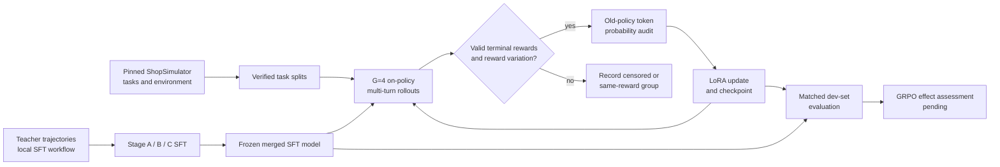

# Shopping Agent Training on a Single GPU

**ShopMini** is an auditable training laboratory for a multi-turn shopping agent. It combines a Qwen3.5-2B policy, LoRA updates, and the [ShopSimulator environment](https://github.com/YYHDBL/shopping-grpo-longhorizon) to study whether an agent can search a catalog, inspect products, use valid tools, and complete a purchase task. The project was developed on one NVIDIA RTX 3090 Ti (24 GB) under Windows.

The key distinction is between **a training system that works** and **an agent that demonstrably shops better**. We have verified synthetic-task updates, checkpoint recovery, multi-turn environment interaction, supervised fine-tuning (SFT) evaluations, and the technical path for on-policy GRPO updates. A matched evaluation showing that GRPO improves shopping success over its SFT starting point is still pending.

> **Publication scope:** This repository contains the reusable ShopMini package, tests, example data/configuration, and selected ShopSimulator integration scripts. It does **not** contain model weights, adapters, checkpoints, generated task splits, raw experiment outputs, the complete SFT training pipeline, or a copy of the upstream simulator. Some results below were produced in the original local workspace and cannot be reproduced from this repository alone. See [publication scope](docs/PUBLICATION_SCOPE.md).

## At a glance

| Area | Current state |
| --- | --- |
| Single-GPU platform | Qwen3.5-2B with LoRA on an RTX 3090 Ti; separate CPU ShopSimulator service |
| Reproducible training checks | Synthetic shopping-task GRPO, probability auditing, checkpoint/resume, and independent adapter reload |
| Multi-turn environment | Pinned ShopSimulator checkout, task-split verification, guarded tool calls, frozen-policy evaluation |
| Supervised learning | Local Stage A/B/C SFT experiments and frozen evaluations completed; training artifacts and full SFT pipeline are not published here |
| On-policy GRPO | Rollout collection, reward filtering, old-policy probability audit, LoRA update, and resume paths technically exercised |
| Shopping improvement from GRPO | **Not established**; paired SFT-start versus GRPO-checkpoint evaluation remains to be done |

## What the agent does

ShopSimulator presents a shopping goal and a changing text observation. The policy chooses an action such as searching, clicking a product, inspecting details, or ending a task. The environment returns the next observation and, on a valid terminal outcome, a reward. Multi-turn work is harder than a single product-selection prompt because every action changes the next context, invalid calls consume budget, and a purchase can be valid without satisfying the exact goal.



The synthetic catalog path in `src/shopmini` is an earlier, independent correctness test: it uses one decision per task and must not be interpreted as multi-turn ShopSimulator performance.

## Experimental evidence

### SFT: a large early gain, followed by mixed incremental changes

On a fixed **50-task held-out development set**, the base Qwen model and Stage A SFT adapter were evaluated with the same BF16 protocol (seed 42, teacher prompt, at most 12 turns, 8,192 prompt tokens, and 192 new tokens per turn). The paired comparison was:

| Metric | Base Qwen | Stage A SFT |
| --- | ---: | ---: |
| Strict shopping successes | **0/50** | **24/50** |
| Valid terminal rewards | 2/50 | 47/50 |
| Executed tool actions / attempted tool actions | 59.4% | 99.0% |

“Strict success” means the exact shopping goal was satisfied; a valid terminal outcome alone is not necessarily a success. Stage A also completed **63 optimizer updates over 252 distinct training tasks**. Its teacher-forced validation loss fell from **0.6336 to 0.3381** on that stage's 27 validation tasks, and independently reloading the adapter produced a maximum absolute logit difference of **0.0**. These observations support a real Stage A improvement on this development protocol; they are not an estimate of generalization to every shopping task.

Stage B and C were then assessed under a separate, matched **FP32** 50-task protocol using merged models:

| Model | Strict successes | Valid terminals | Interpretation |
| --- | ---: | ---: | --- |
| Stage A | 24/50 | 47/50 | Reference for later SFT stages |
| Stage B | 25/50 | 46/50 | One net strict success; individual tasks both improved and regressed |
| Stage C | 25/50 | 43/50 | No net strict-success gain over B; fewer valid terminals |

The BF16 base-versus-Stage-A comparison and the FP32 stage comparison should **not** be combined into one numerical trend. Each stage's training and validation split also differs, so loss values across stages are not directly comparable. In its own frozen run, the Stage C merged model achieved **123/200 strict successes (61.5%)** on the local Final-200 Clean set. That run used a single-GPU, 12K-context Transformers evaluation protocol and is not directly comparable with historical results from the upstream repository. This final set has already been inspected and should not be used repeatedly for checkpoint tuning.

### GRPO: technical validation is ahead of outcome validation

The local workflow can sample groups of current-policy ShopSimulator trajectories, identify valid rewards, audit recomputed token log probabilities, perform LoRA optimizer updates, save checkpoints, and resume. In one no-update signal probe, **3/8 groups** had nonzero advantage, while **4/8 were censored**; the maximum absolute token log-probability audit error was about **6.8 × 10⁻⁵**. This showed that some usable learning signal exists, but it did not train the model or measure a benefit from training.

For a claim that GRPO helped, we still need a paired evaluation of the **same 50 development tasks** from the frozen Stage C starting model and a selected GRPO checkpoint, with the same seed, prompt, precision, context and turn budgets, and reward interpretation. We will report strict successes, valid terminal rate, per-task gains and regressions, reward on comparable valid outcomes, invalid-tool rate, termination reasons, token cost, and GPU memory. Optimizer updates or low probability-audit error alone do not establish shopping improvement.

## Repository layout

```text
src/shopmini/                   Policy, synthetic catalog tasks, objectives,
                                rollouts, audits, artifacts, and simulator boundary
scripts/                        Simulator setup, task splits, frozen baselines,
                                signal probes, and Stage C GRPO entry/update scripts
configs/qwen_smoke.json          Small Qwen LoRA training configuration
data/catalog_tasks.jsonl        Included synthetic product-selection tasks
tests/                          CPU unit tests and conditional upstream checks
docs/PUBLICATION_SCOPE.md       Inclusion/exclusion and validation record
requirements-shopsim-windows.lock.txt
                                Separate simulator environment dependencies
```

Generated files go under ignored `outputs/`, `runtime/`, `models/`, `data/shopsim_splits/`, and `upstream/` paths. Do not commit local model weights, third-party data, environment installations, or evaluation logs by accident.

## Requirements and quick start

- Windows and PowerShell for the commands below; Python **3.12 or 3.13** for ShopMini.
- A CUDA-capable NVIDIA GPU with sufficient free memory for Qwen training; the verified machine was an RTX 3090 Ti with 24 GB VRAM.
- A locally obtained Qwen3.5-2B model for the GPU examples. This repository does not download or redistribute it.
- A PyTorch installation compatible with your NVIDIA driver and CUDA runtime. Verify the actual installed build with `doctor` before GPU work.

From the repository root:

```powershell
python -m venv .venv
.\.venv\Scripts\python.exe -m pip install -e '.[dev]'
.\.venv\Scripts\python.exe -m pytest -q
.\.venv\Scripts\python.exe -m shopmini cpu-smoke --output outputs/cpu-smoke
```

`cpu-smoke` uses a tiny categorical policy, not a language model. Inspect `outputs/cpu-smoke/summary.json`: `checkpoint_reload` should be `true`, with at least one optimizer update. Tests requiring a separate upstream checkout are skipped when it is absent.

On the GPU machine, run:

```powershell
.\.venv\Scripts\python.exe -m shopmini doctor --output outputs/preflight.json
```

The command checks installed packages, `nvidia-smi`, CUDA availability, an actual CUDA backward pass, and BF16 support. It writes `outputs/preflight.json` and exits nonzero if the CUDA backward check fails.

### Synthetic Qwen update

Place an authorized local Qwen3.5-2B checkout at `models/qwen3.5-2b/` and verify that `model_revision` in `configs/qwen_smoke.json` matches your model files. Paths inside that JSON are relative to the config file. Then run:

```powershell
.\.venv\Scripts\python.exe -m shopmini train --config configs/qwen_smoke.json --dry-run
.\.venv\Scripts\python.exe -m shopmini train --config configs/qwen_smoke.json --output-dir outputs/my-qwen-run
```

Use a fresh output directory for each new run. To resume an interrupted run, keep its original config and output directory and add `--resume`. This path tests real Qwen/LoRA optimization on **synthetic, single-decision** catalog tasks. It does not exercise the multi-turn simulator.

## ShopSimulator setup and frozen evaluation

The simulator is an external dependency. This project pins the upstream repository to commit `dc6c9af8e48c8e6325101b39d1d20060f69e4221` and checks that its tracked files are clean. Clone it into the ignored `upstream/` directory:

```powershell
git clone https://github.com/YYHDBL/shopping-grpo-longhorizon.git upstream
git -C upstream checkout dc6c9af8e48c8e6325101b39d1d20060f69e4221
.\.venv\Scripts\python.exe -m pip install uv
.\.venv\Scripts\python.exe scripts/freeze_shopsim_splits.py --write
.\.venv\Scripts\python.exe scripts/freeze_shopsim_splits.py --check
.\.venv\Scripts\python.exe scripts/setup_shopsim.py --install
```

If you store the upstream checkout elsewhere, set `SHOPMINI_UPSTREAM_DIR` to its absolute path before these commands. The generated `data/shopsim_splits/manifest.json` records source hashes and disjointness checks. The local split has **1,073 Stage C SFT training tasks**, **119 SFT validation tasks**, **994 filtered GRPO training tasks**, **50 GRPO development tasks**, and **200 final-evaluation tasks**. The filtered GRPO pool excludes SFT task IDs; the development and final sets remain separate.

`setup_shopsim.py` creates a separate Python 3.10 environment for the CPU simulator using the Windows lock file. Keep the service running in **Terminal A**:

```powershell
.\.venv\Scripts\python.exe scripts/serve_shopsim.py
```

In **Terminal B**, check the API and then try a one-task frozen-policy rollout:

```powershell
.\.venv\Scripts\python.exe scripts/smoke_shopsim.py
.\.venv\Scripts\python.exe scripts/run_shopsim_baseline.py --model-path models/qwen3.5-2b --split validation --max-tasks 1 --output-dir outputs/frozen-baseline-001
```

The baseline script prints its result directory. Inspect its `summary.json` for aggregate metrics and `tasks.jsonl` for task-level trajectories and termination reasons. The service logs in Terminal A show environment requests, but the evaluation result is in Terminal B's output directory. Stop the service with `Ctrl+C` when finished.

### Advanced Stage C GRPO entry points

The published scripts expose three steps: `scripts/prepare_stage_c_grpo.py` validates an existing merged SFT model and its training run; `scripts/stage_c_grpo_entry.py` collects current-policy rollout groups; `scripts/update_stage_c_grpo.py` consumes eligible, audited groups for LoRA updates. Use each script's `--help` to supply your model, SFT-run, manifest, source, and new output paths. These are **not** turnkey from a fresh clone because the complete SFT pipeline and its trained model are outside this publication.

## How to read the metrics

| Metric | Why it matters |
| --- | --- |
| Strict success rate | Fraction of tasks where the exact requested shopping goal was achieved; primary outcome |
| Valid terminal rate | Fraction with a trustworthy environment terminal and reward; measures how often a task can be scored |
| Censored / same-reward / nonzero-advantage groups | Explains whether a GRPO batch contains usable, discriminative reward signal |
| Tool execution and rejection rates | Shows whether the policy emits actions the environment can actually execute |
| Termination reasons | Separates goal purchases from wrong purchases, invalid calls, loops, and exhausted budgets |
| Old-policy log-probability error | Checks that recomputed action-token probabilities agree with rollout-time probabilities before updating |
| Update count, gradient norm, parameter delta | Confirms that optimizer steps occurred; does not measure agent quality |
| Prompt/generated tokens and peak allocated/reserved VRAM | Describes cost and whether the experiment fits on one GPU |

For comparisons, hold task IDs, seed, model/prompt format, precision, context window, generation limits, simulator version, and reward definitions fixed. Keep task-level results so gains and regressions can be reviewed, not just the aggregate score.

## Limitations and next experiment

1. Complete the matched 50-task Stage C SFT-versus-GRPO checkpoint comparison and publish both aggregate and task-level deltas.
2. Investigate censored trajectories and invalid or budget-exhausted tool calls before interpreting additional GRPO updates.
3. Repeat promising results across seeds and document runtime, token cost, GPU peaks, and checkpoint provenance.
4. Treat the already-inspected Final-200 Clean result as an existing observation, not a fresh untouched test for tuning.

This repository is inspired by [YYHDBL/shopping-grpo-longhorizon](https://github.com/YYHDBL/shopping-grpo-longhorizon). The simulator and upstream data stay in a separate pinned checkout. No license has been selected for this repository yet; model and upstream data distribution rights must be considered separately.
